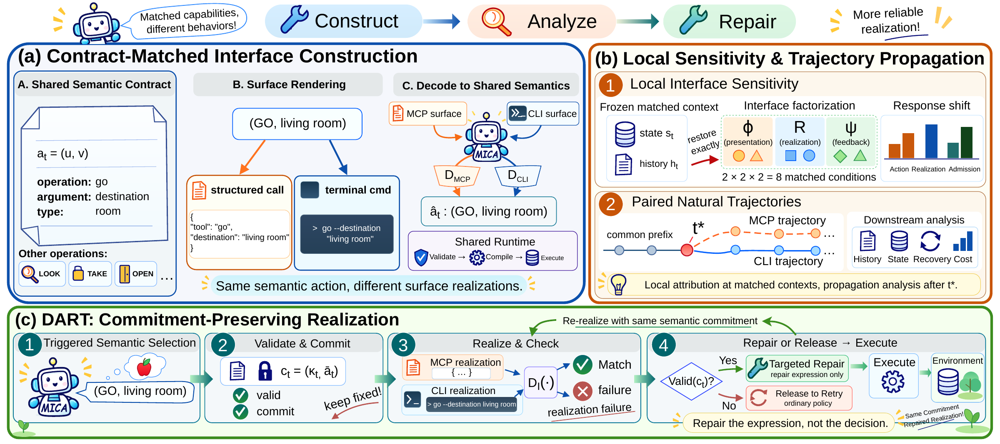

<a name="readme-top"></a>

<div align="center">

  
  <h1>Matched Capabilities, Different Behaviors:<br>A Controlled Study of MCP and CLI Interfaces for Language Agents</h1>
  <a href="https://modalitydance.github.io/MICA/"></a>
  <a href="#citation" title="arXiv link coming soon"></a>
  <a href="#citation" title="Hugging Face Paper link coming soon"></a>
  <a href="./LICENSE"></a>

</div>

<a name="overview"></a>

## 📖 Overview

**MICA (Matched Interface Comparison and Analysis)** studies how Model Context
Protocol (MCP) and command-line (CLI) interfaces shape language-agent behavior
when their executable capabilities are matched. It connects controlled
interface construction, behavioral analysis, and targeted action repair.

### 🪐 Key Features

- **Contract-matched interfaces.** MCP and CLI render a shared semantic action
  contract and use the same validation, native-action compilation, and execution path.
- **Multi-level behavioral analysis.** Factorial probes examine presentation,
  realization, and feedback; paired trajectories track how behavior separates over an episode.
- **Commitment-preserving repair.** DART (Decoupled Action Realization and Targeted Repair)
  preserves a validated semantic action while repairing its interface-specific expression.

<div align="center">
  <a href="./assets/overview.pdf"></a>
  <p><em>Construct matched interfaces, analyze agent behavior, and repair action realizations.</em></p>
</div>

## 🔥 News

- **[2026.10]** The MICA implementation is available in this repository, with matched MCP/CLI interfaces, DART, and behavioral analysis tools.

## 📑 Table of Contents

- [🚀 Quick Start](#quick-start)
  - [1. Installation](#installation)
  - [2. Benchmark Data](#benchmark-setup)
  - [3. Model Services](#models)
  - [4. Running](#running)
    - [MCP–CLI Comparison](#mcp-cli-comparison)
    - [DART and Controls](#dart-and-controls)
  - [5. Evaluation and Analysis](#evaluation)
    - [Factorial Probes](#probes-and-analysis)
- [🧪 Usage Example](#usage-example)
- [✨ How It Works](#how-it-works)
- [🌱 Acknowledgements](#acknowledgements)
- [📚 Citation](#citation)

<a name="getting-started"></a>
<a name="quick-start"></a>

## 🚀 Quick Start

<a name="installation"></a>

### 1. Installation

Use **Python 3.10–3.12**:

```bash
git clone https://github.com/ModalityDance/MICA.git
cd MICA
python -m venv .venv
source .venv/bin/activate
python -m pip install --upgrade pip
python -m pip install -e .
cp -n .env.example .env
```

#### Environment Settings

Edit dataset paths and service settings in your local `.env` using the
[environment template](.env.example), then load it before running MICA:

```bash
set -a
source .env
set +a
```

#### Configuration Check

```bash
mica run --benchmark configs/benchmarks/alfworld.yaml \
  --model configs/models/qwen3_4b.yaml --interface mcp --policy base \
  --output outputs/alfworld_mcp --dry-run
```

> [!TIP]
> Use `--dry-run` to check the configuration. After preparing a benchmark and
> model service below, follow [Running](#running) to collect episodes.

<details>
<summary>Separate Python environments</summary>

Set `ALFWORLD_PYTHON`, `WEBSHOP_PYTHON`, or `SCIENCEWORLD_PYTHON` to the worker's
Python executable to use a separate environment. Install this package and the
corresponding benchmark dependencies there. The vLLM server can also use its
own environment.

</details>

<a name="benchmarks"></a>
<a name="benchmark-setup"></a>

### 2. Benchmark Data

Install the benchmark you want to use. The supplied [task manifests](configs/tasks/)
fix task identities, order, and environment seeds across interfaces.

| Benchmark | Performance metrics |
| --- | --- |
| [ALFWorld](https://github.com/alfworld/alfworld) | Success |
| [WebShop](https://github.com/princeton-nlp/WebShop) | Reward and success |
| [ScienceWorld](https://github.com/allenai/ScienceWorld) | Normalized score and success |

#### ALFWorld

```bash
python -m pip install -e '.[alfworld]'
export ALFWORLD_DATA=data/alfworld
alfworld-download
python scripts/prepare_benchmarks.py --benchmark alfworld
```

> [!NOTE]
> This installs `alfworld==0.4.2`. Set `ALFWORLD_DATA` to the directory containing
> `json_2.1.1/valid_unseen/` and `logic/`. TextWorld settings are in the
> [environment configuration](configs/environments/alfworld.yaml).

#### WebShop

```bash
python -m pip install -e '.[webshop]'
git clone https://github.com/princeton-nlp/webshop.git external/webshop
mkdir -p external/webshop/data
gdown 'https://drive.google.com/uc?id=1EgHdxQ_YxqIQlvvq5iKlCrkEKR6-j0Ib' -O external/webshop/data/items_shuffle_1000.json
gdown 'https://drive.google.com/uc?id=1IduG0xl544V_A_jv3tHXC0kyFi7PnyBu' -O external/webshop/data/items_ins_v2_1000.json
gdown 'https://drive.google.com/uc?id=14Kb5SPBk_jfdLZ_CDBNitW98QLDlKR5O' -O external/webshop/data/items_human_ins.json
export WEBSHOP_ROOT=external/webshop
python scripts/prepare_benchmarks.py --benchmark webshop
```

> [!NOTE]
> Set `WEBSHOP_ROOT` to the checkout containing `web_agent_site/` and `data/`.
> Downloads are listed in [configs/assets.json](configs/assets.json); observation
> settings are in [webshop.yaml](configs/benchmarks/webshop.yaml).

#### ScienceWorld

Install OpenJDK 11 and make `java` available on `PATH`, then install the Python
package:

```bash
python -m pip install -e '.[scienceworld]'
java -version
python scripts/prepare_benchmarks.py --benchmark scienceworld
```

This installs `scienceworld==1.2.3`.

<a name="models"></a>

### 3. Model Services

Use a local vLLM server or an OpenAI-compatible API with the corresponding
model configuration:

| Configuration | Model | Runtime settings |
| --- | --- | --- |
| [qwen3_4b.yaml](configs/models/qwen3_4b.yaml) | [Qwen3-4B](https://huggingface.co/Qwen/Qwen3-4B) | `QWEN3_4B_PATH`, local vLLM endpoint |
| [qwen3_8b.yaml](configs/models/qwen3_8b.yaml) | [Qwen3-8B](https://huggingface.co/Qwen/Qwen3-8B) | `QWEN3_8B_PATH`, local vLLM endpoint |
| [qwen3_14b.yaml](configs/models/qwen3_14b.yaml) | [Qwen3-14B](https://huggingface.co/Qwen/Qwen3-14B) | `QWEN3_14B_PATH`, local vLLM endpoint |
| [qwen3_32b.yaml](configs/models/qwen3_32b.yaml) | [Qwen3-32B](https://huggingface.co/Qwen/Qwen3-32B) | `QWEN3_32B_PATH`, local vLLM endpoint |
| [deepseek_flash.yaml](configs/models/deepseek_flash.yaml) | DeepSeek-v4-Flash | `API_BASE_URL`, `API_KEY`, optional `DEEPSEEK_MODEL` |
| [gemini_flash.yaml](configs/models/gemini_flash.yaml) | Gemini-2.5-Flash | `API_BASE_URL`, `API_KEY`, optional `GEMINI_MODEL` |

#### Local Models with vLLM

Download the model and install vLLM in your serving environment:

```bash
python -m pip install vllm huggingface_hub
hf download Qwen/Qwen3-4B --local-dir models/Qwen3-4B
```

Start Qwen3-4B in a separate terminal:

```bash
export QWEN3_4B_PATH=models/Qwen3-4B
export LOCAL_MODEL_BASE_URL=http://127.0.0.1:8000/v1
CUDA_VISIBLE_DEVICES=0 vllm serve "$QWEN3_4B_PATH" \
  --served-model-name qwen3_4b \
  --host 127.0.0.1 --port 8000 \
  --dtype bfloat16 --max-model-len 40960 \
  --reasoning-parser qwen3 \
  --enable-prefix-caching
```

> [!NOTE]
> Match `--served-model-name` to the model configuration: `qwen3_4b`, `qwen3_8b`,
> `qwen3_14b`, or `qwen3_32b`. Set GPUs, tensor parallelism, memory utilization,
> and sequence limits for your hardware when launching vLLM.

#### Models through an API

Set `API_BASE_URL` and `API_KEY` in your local `.env`, then load it as shown in
[Quick Start](#quick-start). Set `DEEPSEEK_MODEL` or
`GEMINI_MODEL` if your endpoint uses different model aliases.

<a name="experiments"></a>
<a name="running"></a>

### 4. Running

<a name="mcp-cli-comparison"></a>

#### MCP–CLI Comparison

Run the same task set through both interfaces using the same benchmark and
model configuration, with a separate output directory for each run:

```bash
mica run --benchmark configs/benchmarks/alfworld.yaml \
  --model configs/models/qwen3_4b.yaml --interface mcp --policy base \
  --workers 8 --capture-contexts --output outputs/alfworld_mcp
mica run --benchmark configs/benchmarks/alfworld.yaml \
  --model configs/models/qwen3_4b.yaml --interface cli --policy base \
  --workers 8 --output outputs/alfworld_cli
```

Switch the benchmark or model YAML to use another setting. `--workers` sets
episode concurrency; `--interface native` selects the native-command interface.

> [!NOTE]
> Choose a new output directory for each run. Add `--capture-contexts` to the
> MCP Base run when collecting contexts for [factorial probes](#probes-and-analysis).

<details>
<summary>Configuration and custom task sets</summary>

Settings are merged from [shared defaults](configs/base.yaml),
[benchmark](configs/benchmarks/), [model](configs/models/), and optional
[method](configs/methods/) configurations, in that order. These YAML files
set generation options, episode budgets, and controller settings. Use
`--config` to select a different shared configuration.

Pass an alternative task manifest with `--tasks`, including full task
specifications and environment seeds. To create a subset with `mica prepare-tasks`,
provide `--scenario` for ALFWorld and ScienceWorld.

</details>

<a name="dart-and-controls"></a>

#### DART and Controls

Run DART and its Base comparison with [configs/methods/dart.yaml](configs/methods/dart.yaml):

```bash
mica run --benchmark configs/benchmarks/webshop.yaml \
  --model configs/models/gemini_flash.yaml \
  --method configs/methods/dart.yaml --interface cli --policy dart \
  --workers 4 --output outputs/webshop_dart
mica run --benchmark configs/benchmarks/webshop.yaml \
  --model configs/models/gemini_flash.yaml \
  --method configs/methods/dart.yaml --interface cli --policy base \
  --workers 4 --output outputs/webshop_base
```

> [!NOTE]
> Use the same benchmark, model, interface, and method overlay for Base and DART
> so their shared settings agree.

Select the controller with `--policy`:

| Policy | What changes |
| --- | --- |
| `base` | Ordinary policy and retry path |
| `dart` | Semantic commitment, model realization, and optional preserving correction |
| `deterministic` | Reference encoder replaces model realization after semantic selection |
| `reselection` | Correction may choose a different semantic action instead of preserving the commitment |

<a name="evaluation"></a>

### 5. Evaluation and Analysis

The runs above use the selected model service, such as
[Qwen3-4B](https://huggingface.co/Qwen/Qwen3-4B). Each episode records task performance
and its interaction trace. Summarize completed runs with:

```bash
mica analyze --runs outputs/alfworld_mcp outputs/alfworld_cli \
  --output outputs/alfworld_analysis --bootstrap-samples 10000 --seed 0
mica analyze --runs outputs/webshop_base outputs/webshop_dart \
  --output outputs/webshop_analysis --bootstrap-samples 10000 --seed 0
```

Analysis summarizes task performance, paired comparisons, failure and recovery,
trajectory divergence, and DART diagnostics. The main exports are
`episodes.csv`, `paired_contrasts.csv`, `recovery_summary.csv`,
`propagation_summary.csv`, `dart_summary.csv`, and `phase_cost_summary.csv`.

<a name="probes-and-analysis"></a>

#### Factorial Probes

Use an MCP Base run recorded with `--capture-contexts` to select public
decision contexts before sampling responses:

```bash
mica select-contexts --runs outputs/alfworld_mcp \
  --count 8 --depths 0 1 2 3 --output outputs/alfworld_contexts
```

The probe runner holds the supplied contract and public history fixed while
varying **presentation, realization, and feedback** over all eight MCP/CLI
assignments. The default is eight samples per assignment at temperature 0.6.

```bash
mica probe --contexts outputs/alfworld_contexts/contexts.json \
  --config configs/probes.yaml \
  --model-config configs/models/qwen3_4b.yaml \
  --samples 8 --output outputs/alfworld_probes --dry-run
```

> [!TIP]
> Remove `--dry-run` to collect probe responses with the configured model service.

Analyze saved probe responses:

```bash
mica analyze-probes --runs outputs/alfworld_probes \
  --output outputs/alfworld_probe_analysis --bootstrap-samples 10000 --seed 0
```

Probe exports include `task_aggregates.csv` and `factorial_effects.csv`.

<a name="usage-example"></a>

## 🧪 Usage Example

After preparing ALFWorld, loading `.env`, and starting the Qwen3-4B service,
run one task through both interfaces from Python:

```python
import json
from pathlib import Path

from mcp_cli.configuration import load_configuration, load_task_records
from mcp_cli.runner import run_experiment

tasks = load_task_records("configs/tasks/alfworld.json", benchmark="alfworld")[:1]

for interface in ("mcp", "cli"):
    config = load_configuration(
        ["configs/base.yaml", "configs/benchmarks/alfworld.yaml",
         "configs/models/qwen3_4b.yaml"],
        overrides={"interface": {"type": interface}},
    )
    output = Path(f"outputs/example_{interface}")
    run_experiment(config, tasks, output=output, policy_name="base", workers=1)

    record = json.loads((output / "episodes/000001.json").read_text())
    episode = record["episode_row"]
    print(interface, episode["success"], episode["native_metrics"])
```

<a name="how-it-works"></a>

## ✨ How It Works

1. **Construct matched interfaces.** Render a shared semantic action contract as
   MCP or CLI. Decode both surfaces into a common action representation before
   validation, native-action compilation, and execution.
2. **Analyze interface behavior.** Vary presentation, realization, and feedback at
   a fixed public decision context. Pair natural trajectories to examine how
   action choices, recovery, and task outcomes evolve over an episode.
3. **Repair action realizations.** After a triggering failure, DART establishes
   a valid semantic commitment and repairs its expression while that commitment
   remains valid. Otherwise, it releases to the ordinary retry path.

<a name="acknowledgements"></a>

## 🌱 Acknowledgements

We thank the teams behind [Qwen3](https://github.com/QwenLM/Qwen3),
[ALFWorld](https://github.com/alfworld/alfworld),
[WebShop](https://github.com/princeton-nlp/WebShop),
[ScienceWorld](https://github.com/allenai/ScienceWorld),
[vLLM](https://github.com/vllm-project/vllm), and
[Transformers](https://github.com/huggingface/transformers) for their
open-source models, environments, and tools.

MICA is licensed under the [MIT License](LICENSE).

<a name="citation"></a>

## 📚 Citation

Please cite our work as:

```bibtex
@misc{shi2026mica,
  title  = {Matched Capabilities, Different Behaviors: A Controlled Study of MCP and CLI Interfaces for Language Agents},
  author = {Zhenning Shi and Liang Pang and Yongqi Li},
  year   = {2026},
  url    = {https://github.com/ModalityDance/MICA}
}
```

<div align="center">
  <a href="https://github.com/ModalityDance/MICA">
    
  </a>
  <a href="https://github.com/ModalityDance/MICA/issues">
    
  </a>
</div>
